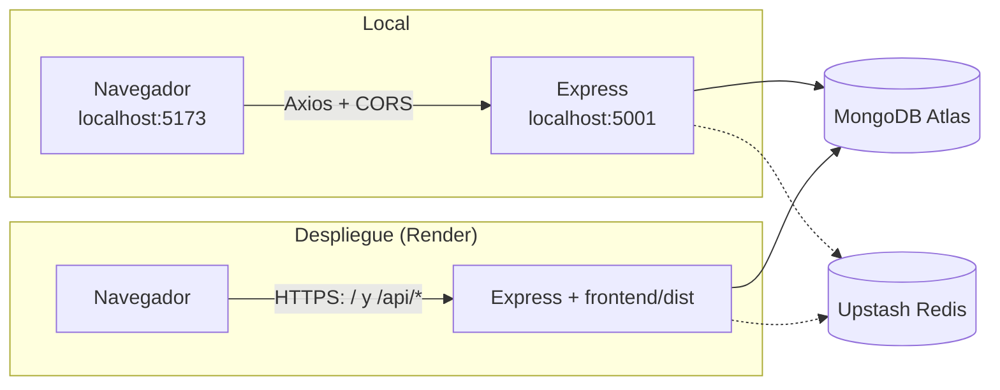

<h1 align="center">Notebletus</h1>

Aplicación web de notas (crear, listar, ver, editar y eliminar) con estética de cuaderno de papel, construida con el stack MERN. Proyecto de la asignatura Proyecto de Desarrollo Web (Universidad Americana).

- **Repositorio:** https://github.com/Fedebarriosd/notebletus
- **Aplicación desplegada:** `<URL_DE_LA_APP>` _(completar tras el despliegue)_
- **API desplegada:** `<URL_DE_LA_APP>/api/notes` _(misma URL: un solo servicio sirve la app y la API)_

## Tecnologías

| Capa | Tecnología |
|------|-----------|
| Frontend | React 19, Vite 6, React Router 7, Tailwind CSS 3 + DaisyUI, Axios, react-hot-toast |
| Backend | Node.js, Express 4, Mongoose 8 |
| Base de datos | MongoDB (MongoDB Atlas) |
| Rate limiting | Upstash Redis (`@upstash/ratelimit`) |
| Despliegue | Render (servicio web único, ver `render.yaml`) |

## Arquitectura



- **Local:** el frontend (Vite, puerto 5173) y el backend (Express, puerto 5001) corren por separado; el backend habilita CORS solo para `http://localhost:5173`.
- **Desplegado:** un único servicio Node compila el frontend y Express sirve `frontend/dist` junto con la API bajo `/api`. Al ser el mismo origen, el frontend llama a `/api` (no a `localhost`) y no hace falta CORS.
- Cada petición a la API pasa por el middleware de rate limiting (Upstash) antes de llegar a las rutas.

## Estructura del repositorio

```
notebletus/
├── backend/
│   ├── src/
│   │   ├── server.js            # arranque de Express, CORS, rutas y servido del frontend en producción
│   │   ├── config/              # db.js (Mongoose) y upstash.js (rate limiter)
│   │   ├── controllers/         # notesController.js (lógica de cada endpoint)
│   │   ├── middleware/          # rateLimiter.js
│   │   ├── models/Note.js       # esquema de Mongoose
│   │   └── routes/notesRoutes.js
│   ├── scripts/                 # init-db.js y show-db.js (preparación y consulta de la BD)
│   └── .env.example
├── frontend/
│   ├── src/ (pages, components, lib/axios.js)
│   └── .env.example
├── docs/modelo-datos.md         # modelo de datos (Indicador 5)
├── render.yaml                  # configuración de despliegue en Render
└── package.json                 # scripts de build/start para el despliegue
```

## Requisitos previos

- Node.js **20 o superior** y npm.
- Una base MongoDB (cuenta gratuita en [MongoDB Atlas](https://www.mongodb.com/atlas) o MongoDB local).
- Una base Redis gratuita en [Upstash](https://console.upstash.com) (para el rate limiting).

## Instalación

```bash
git clone https://github.com/Fedebarriosd/notebletus.git
cd notebletus
npm install --prefix backend
npm install --prefix frontend
```

## Variables de entorno

Copiar la plantilla y completar con credenciales propias (el archivo `.env` real no se sube al repositorio):

```bash
cp backend/.env.example backend/.env
```

| Variable | Dónde | Descripción |
|----------|-------|-------------|
| `MONGO_URI` | backend | Cadena de conexión de MongoDB (Atlas o local). |
| `UPSTASH_REDIS_REST_URL` | backend | URL REST de la base Redis de Upstash. |
| `UPSTASH_REDIS_REST_TOKEN` | backend | Token REST de Upstash. |
| `NODE_ENV` | backend | `development` en local, `production` en el despliegue. |
| `PORT` | backend | Opcional. Por defecto `5001`; las plataformas lo inyectan solas. |
| `VITE_API_URL` | frontend | Opcional. Solo si el frontend se publica en un dominio distinto al del backend (ver `frontend/.env.example`). |

En el despliegue las variables se cargan en el panel de la plataforma, nunca en el repositorio.

## Preparación de la base de datos

Con `MONGO_URI` configurada en `backend/.env`:

```bash
cd backend
npm run db:init   # crea la colección "notes" y sincroniza índices
npm run db:show   # muestra los documentos directamente desde MongoDB (sin pasar por la API)
```

La colección también se crea sola al guardar la primera nota. Modelo de datos: [`docs/modelo-datos.md`](docs/modelo-datos.md).

## Comandos de arranque

**Desarrollo (dos terminales):**

```bash
# Terminal 1 – backend en http://localhost:5001
cd backend
npm run dev

# Terminal 2 – frontend en http://localhost:5173
cd frontend
npm run dev
```

**Modo producción (lo que ejecuta el despliegue; un solo proceso):**

```bash
npm run build                      # instala dependencias y compila el frontend en frontend/dist
NODE_ENV=production npm start      # Express sirve la API y el frontend (puerto 5001 o $PORT)
```

## Acceso local y desplegado

| Entorno | Aplicación | API |
|---------|-----------|-----|
| Desarrollo local | http://localhost:5173 | http://localhost:5001/api/notes |
| Producción local (`npm start`) | http://localhost:5001 | http://localhost:5001/api/notes |
| Desplegado | `<URL_DE_LA_APP>` | `<URL_DE_LA_APP>/api/notes` |

### Despliegue en Render

1. Crear un cluster en MongoDB Atlas y una base en Upstash; en Atlas permitir el acceso de red desde Render (por ejemplo `0.0.0.0/0` para una demostración).
2. En Render: **New → Blueprint** y seleccionar este repositorio (usa `render.yaml`), o crear un **Web Service** manual con *Build Command* `npm run build` y *Start Command* `npm start`.
3. Cargar `MONGO_URI`, `UPSTASH_REDIS_REST_URL` y `UPSTASH_REDIS_REST_TOKEN` en el panel (`NODE_ENV=production` ya viene en `render.yaml`).
4. Al terminar el build, abrir la URL pública asignada. El plan gratuito se suspende por inactividad: la primera petición puede tardar unos segundos.

## API (endpoints)

Base: `/api/notes`

| Método | Ruta | Propósito | Respuestas |
|--------|------|-----------|------------|
| GET | `/api/notes` | Lista todas las notas (más recientes primero) | 200 |
| GET | `/api/notes/:id` | Devuelve una nota | 200, 400, 404 |
| POST | `/api/notes` | Crea una nota (`title` y `content` obligatorios) | 201, 400 |
| PUT | `/api/notes/:id` | Actualiza título y contenido de una nota | 200, 400, 404 |
| DELETE | `/api/notes/:id` | Elimina una nota | 200, 400, 404 |

Cualquier ruta puede responder `429` (límite de peticiones excedido) o `500` (error interno).

Ejemplo:

```bash
curl -X POST http://localhost:5001/api/notes \
  -H "Content-Type: application/json" \
  -d '{"title":"Mi nota","content":"Hola"}'
# 201 → {"_id":"...","title":"Mi nota","content":"Hola","createdAt":"...","updatedAt":"..."}

curl -X POST http://localhost:5001/api/notes -H "Content-Type: application/json" -d '{"title":" "}'
# 400 → {"message":"Title and content are required","missing":["title","content"]}
```

## Funciones

| Funcionalidad | Estado |
|---------------|--------|
| Listar notas | Implementada |
| Crear nota con validación (frontend y backend) | Implementada |
| Ver detalle de una nota | Implementada |
| Editar nota | Parcial: valida en el frontend, el backend no valida el cuerpo del `PUT` |
| Eliminar nota | Implementada |
| Persistencia en MongoDB | Implementada |
| Limitación de peticiones (rate limiting) | Implementada, con una cuota global compartida |
| Interfaz tipo cuaderno de papel | Implementada |
| Búsqueda, etiquetas, usuarios y autenticación | Futura |

## Limitaciones

- **Sin autenticación:** todas las notas son públicas para quien acceda a la aplicación.
- **Rate limiting global:** el límite (100 peticiones por minuto) usa una única clave para todos los usuarios, no una por IP.
- **`PUT` sin validación en el backend:** se puede dejar una nota con campos vacíos si se llama a la API directamente.
- **Sin pruebas automatizadas:** la verificación se hizo manualmente (ver PDF técnico).
- **Plan gratuito:** el servicio de Render entra en reposo tras un periodo de inactividad.
