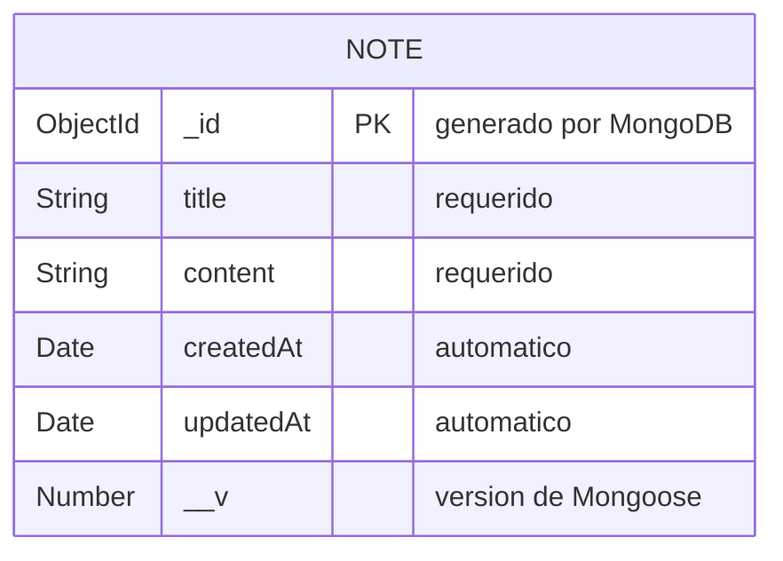

# Modelo de datos – Notebletus (Indicador 5)

Gestor: **MongoDB** (MongoDB Atlas) · Acceso: **Mongoose** desde el backend · Base: `notebletus` · Colección: `notes`

Una sola entidad (la nota), sin claves foráneas ni relaciones en esta etapa.

| Atributo  | Tipo     | Restricción              | Descripción                          |
|-----------|----------|--------------------------|--------------------------------------|
| `_id`     | ObjectId | PK                       | Identificador único                  |
| `title`   | String   | required                 | Título de la nota                    |
| `content` | String   | required                 | Contenido de la nota                 |
| `createdAt` | Date   | automático (timestamps)  | Fecha de creación                    |
| `updatedAt` | Date   | automático (timestamps)  | Fecha de última modificación         |

Definición: `backend/src/models/Note.js`. Creación de la colección: `npm run db:init` (en `backend/`).
Consulta directa a la base: `npm run db:show`.
